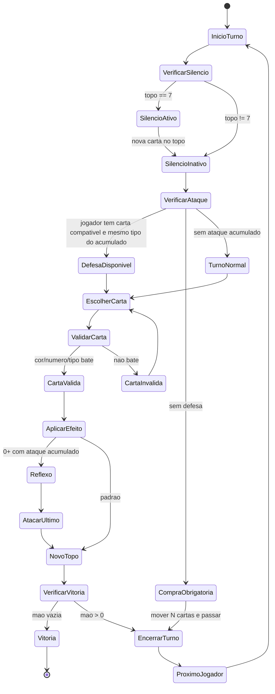
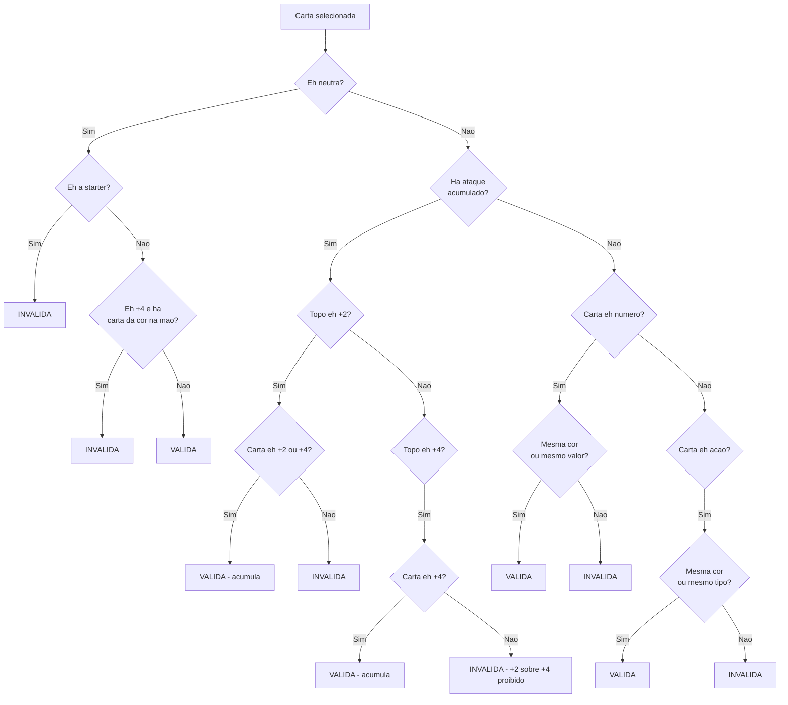

# 04 — Pitch, Anexos e Referências Operacionais

> Documento de pitch executivo + material de apoio (manual rápido, glossário, fluxos, tabelas, matriz de riscos). Linguagem dev-ready, terminologia canônica do projeto. Este arquivo NÃO é jogável; é referência.

---

## 1. Pitch Executivo (1 página)

**Kabemjunto** é um jogo de cartas digital para 2–10 jogadores, baseado em um baralho de 108 cartas, com partidas de 8–15 minutos. Combina a familiaridade do "tipo UNO" com três camadas de profundidade estratégicas: **regra do 7 (silêncio social)**, **acúmulo assimétrico de ataques** (+2 sobre +2, +4 sobre +4, mas +2 sobre +4 é proibido) e a carta **0+ (Zero Mais)**, que reflete o ataque acumulado de volta para o último atacante. É projetado para sessões casuais em mobile e desktop, com multiplayer local (hot-seat) e online.

**Problema.** O mercado de jogos de cartas casuais digitais está saturado por clones genéricos de UNO com pouca inovação mecânica e zero camada social. Títulos de mesa como UNO, Taki, Phase 10 sofrem com barreira física (mesa, marcador, distribuição) e carecem de moderação contra trapaças em partidas online. Apps de cartas tradicionais tratam o jogo como 1v1 ou 4 jogadores fixos — nenhum escala bem para 8–10 jogadores em uma única partida.

**Solução.** Kabemjunto digitaliza o baralho canônico de 108 cartas, implementa um motor de regras estrito em servidor autoritativo (anti-trapaça) e introduz três mecânicas próprias que geram momentos de mesa memoráveis: a regra do 7 transforma o jogo em brincadeira social (quem falar paga), a assimetria de acúmulo obriga leitura tática do topo, e o 0+ cria reviravoltas cinematográficas. Sessões curtas (8–15 min) com setup zero e matchmaking por código de sala.

**Mercado.** Mobile casual + party games digitais. Endereça o segmento de jogadores 18–35 que jogam em grupo (WhatsApp/Discord/presencial), famílias em reunião e universitários. TAM comparável ao de UNO Mobile (100M+ downloads cumulativos). Diferencial: suporte nativo a até 10 jogadores por sala + modo de silêncio social que viraliza em lives/streaming.

**Diferencial.**

- **Até 10 jogadores por partida** (vs. 4 da maioria dos concorrentes).
- **Regra do 7 social**: o jogo "ouve" — quem falar leva +2, criando momentos de stream.
- **0+ (Zero Mais)**: única carta que reflete o ataque acumulado; motor precisa de fila de "último atacante".
- **Baralho canônico de 108**: 4 cores × (0–9) + 4 ações (Skip, Reverse, +2) + 4 neutras (+4, Troca Mão, Gira Mão, 0+, Coringa).
- **Partidas curtas** (8–15 min) → alta retenção por sessão.

**Modelo de receita.** Free-to-play com sala grátis (até 4 jogadores, sem customização) + assinatura premium (até 10 jogadores, baralhos temáticos, perfil com estatísticas, sem anúncios). Skins de carta como compra única (cosmética, não pay-to-win). Estimativa: 2–4% conversão free→premium em party games do segmento.

**Por que agora.** (1) Pico de jogos de mesa híbridos (físico+app) pós-pandemia, com base instalada de UNO/Mao já educada. (2) Multiplayer online de baixa latência agora viável com WebSocket + server authoritative em cloud (Fly.io / Hetzner / Railway). (3) Marketing orgânico via TikTok/Twitch: regra do 7 é o tipo de mecânica que viraliza em clipes curtos. (4) Crescimento de jogos "anti-stress" casuais em sessões de 10 min.

---

## 2. Manual Rápido — Cola de Uma Página

**Setup**

- 2–10 jogadores. Cada um recebe **7 cartas** viradas para baixo.
- Monte de Compra (virado para baixo) + Monte de Descarte (começa com 1 carta; **não pode ser neutra**; se for, vira a próxima).
- Cada jogador vê só as próprias cartas. Estado oculto do resto.

**Turno (ordem fixa)**

1. **Verificar Silêncio**: se um 7 está no topo, ninguém pode falar até que outra carta seja jogada. Falar = +2 cartas (vai pro monte de compra, fonte: regra do 7).
2. **Verificar Ataque Acumulado**: se há +2 ou +4 pendente, o jogador deve (a) **defender jogando o mesmo tipo** (regras de acúmulo abaixo) ou (b) **comprar o acumulado** e passar o turno.
3. **Jogar 1 carta** compatível com o topo OU **comprar 1 carta** (e, opcionalmente, jogá-la imediatamente se válida).
4. Se a carta jogada for **0+ (Zero Mais)** e há ataque acumulado, o ataque **reflete** para o último atacante.
5. **Direção de Jogo** é mantida (horário padrão). Reverse inverte; Skip pula 1; +N força compra; etc.
6. Vez passa ao próximo jogador vivo.

**Compatibilidade de carta (regra geral)**

- Mesma **cor** OU mesmo **número/valor** OU **carta neutra** (sempre compatível).
- A **primeira carta** virada do descarte não pode ser neutra; o dealer reembaralha se for.

**Ações-chave**

- **Skip** (⤳): próximo jogador perde o turno.
- **Reverse** (⇄): inverte direção; em 2 jogadores, vira Skip.
- **+2** (vermelho/azul/amarelo/verde, com "+2"): próximo compra 2; se jogado sobre +2 ou +4 do mesmo tipo, **acumula**.
- **+4** (neutra, multicolor): próximo compra 4; só jogável se **sem carta da cor atual na mão**; coringa declara próxima cor; **+4 sobre +4 acumula**, mas **+2 sobre +4 é PROIBIDO** (deve comprar o 4 e encerrar a cadeia).
- **Troca Mão** (neutra): troca toda a mão com jogador à escolha (não pode ser 0 cartas, mas pode ser você mesmo em 2 jogadores).
- **Gira Mão** (neutra): todos os jogadores passam a mão ao próximo em direção (sem incluir você).
- **0+ (Zero Mais)** (neutra): todos passam a mão ao próximo + se há ataque acumulado, **reflete** para o último atacante.
- **Coringa Simples** (neutra): só muda a cor ativa; sem efeito mecânico extra.
- **7** (qualquer cor, número 7): **regra do silêncio** — ninguém pode falar até a próxima carta; quem falar (incluindo o próprio jogador) **compra 2**.

**Acúmulo de ataques (tabela canônica)**

_Legenda: linhas = carta do TOPO (pendente); colunas = carta que o próximo jogador quer JOGAR. "OK" = pode acumular; "PROIBIDO" = não pode jogar essa carta, deve comprar o acumulado._

| Topo \ Carta a jogar | +2           | +4          |
| -------------------- | ------------ | ----------- |
| **Topo = +2**        | OK (soma 4)  | OK (soma 6) |
| **Topo = +4**        | **PROIBIDO** | OK (soma 8) |

Quando "PROIBIDO", o defensor **deve comprar o acumulado e passar o turno**.

**Fim de jogo**

- Vence quem **descartar a última carta** (incluindo na compra obrigatória, se a carta comprada for jogável e o jogador a jogar).
- Empate impossível: 1 vencedor por partida.
- Em caso de monte de compra acabar, **reembaralha-se o descarte** (exceto a carta do topo).

---

## 3. Glossário (≥ 15 termos)

| Termo                  | Definição                                                                                                                                                                                                          |
| ---------------------- | ------------------------------------------------------------------------------------------------------------------------------------------------------------------------------------------------------------------ |
| **Monte de Compra**    | Pilha fechada de onde jogadores compram cartas. Quando esgota, o descarte (exceto o topo) é reembaralhado para reabastecê-lo.                                                                                      |
| **Monte de Descarte**  | Pilha aberta onde cartas são jogadas. Apenas o **topo** importa para validar jogadas.                                                                                                                              |
| **Topo**               | Última carta do Monte de Descarte. É a única referência para validar compatibilidade.                                                                                                                              |
| **Turno**              | Janela de ação de 1 jogador: começa no aviso de vez, passa por jogar/comprar, e encerra na transferência ao próximo jogador vivo.                                                                                  |
| **Direção de Jogo**    | Ordem de transferência de turno. Padrão: horário. Invertida por **Reverse**. Em 2 jogadores, Reverse equivale a Skip.                                                                                              |
| **Coringa**            | Qualquer carta neutra (sem cor própria). Pode ser jogada sobre qualquer topo. **Coringa Simples** só muda cor; **+4**, **Troca Mão**, **Gira Mão**, **0+** têm efeitos próprios.                                   |
| **Ataque Acumulado**   | Cadeia de cartas de compra forçada pendente sobre o próximo jogador. Tem tipo (+2 ou +4) e total. Quem recebe deve defender com mesmo tipo ou comprar tudo.                                                        |
| **Reflexo**            | Efeito exclusivo do **0+**: quando há ataque acumulado, transfere a obrigação de compra de volta para o último atacante, mantendo tipo e total.                                                                    |
| **Compra Obrigatória** | Ação forçada de mover N cartas do Monte de Compra para a mão, sem possibilidade de jogar na mesma janela (a menos que a regra local permita jogar a carta comprada imediatamente, o que é a convenção do projeto). |
| **Silêncio**           | Estado ativado por jogar uma carta de número 7. Dura até que outra carta seja descartada. Quem falar durante silêncio **+2 cartas** (vai pra mão, não pro descarte).                                               |
| **Regra do 7**         | Nome popular da mecânica de Silêncio. Pode ser ativada por qualquer 7 (todas as cores têm 7).                                                                                                                      |
| **Mão**                | Conjunto de cartas que um jogador segura, visível só para ele. Origem das jogadas.                                                                                                                                 |
| **Descartar**          | Mover uma carta da mão para o topo do Monte de Descarte. É o que termina a ação de jogar.                                                                                                                          |
| **Ativo**              | Refere-se ao estado atual: cor ativa, jogador ativo, ataque ativo, silêncio ativo. "X está ativo" significa que X está em vigor e pode produzir efeito.                                                            |
| **Starter**            | Primeira carta do Monte de Descarte. Definida no setup; restrição: **nunca pode ser neutra** (se for, reembaralha-se até uma não-neutra).                                                                          |
| **Vazio**              | Estado da mão com 0 cartas. Vitória instantânea do jogador. Regra típica: 1 carta na mão + compra obrigatória pode permitir "gritar UNO" análogo (decisão de design a confirmar).                                  |
| **Jogador Vivo**       | Jogador cuja mão tem ≥ 1 carta. Não há eliminação clássica; quem fica com 0 só não joga mais. (Decisão de design: partidas podem terminar quando só 1 vivo tem cartas.)                                            |
| **Defesa**             | Jogar uma carta de ataque (do mesmo tipo do acumulado) sobre o topo para não comprar e transferir a obrigação.                                                                                                     |
| **Cadeia**             | Sequência de cartas de ataque empilhadas (+2 +2 +2 ou +4 +4 +4 +4). Termina quando alguém defende com mesmo tipo ou compra o total.                                                                                |
| **Último Atacante**    | Jogador que jogou a carta que originou o ataque acumulado atual. Usado pelo 0+ para refletir.                                                                                                                      |

---

## 4. Diagrama de Fluxo de Turno (State Machine)



**Estados (legenda para devs)**

- `VerificarSilencio`: lê o topo; se for 7, marca `silencioAtivo=true`.
- `VerificarAtaque`: lê `ataqueAcumulado`; se > 0, decide defesa ou compra.
- `DefesaDisponivel`: existe ≥1 carta na mão compatível **E** do mesmo tipo do acumulado (só se acumulado for +2 ou +4).
- `EscolherCarta`: input do jogador (UI lista cartas válidas e jogáveis).
- `ValidarCarta`: chama `validarJogada(carta, topo, mao, estado)` (ver §5).
- `AplicarEfeito`: dispatch por `carta.tipo` → chama handler (Skip, Reverse, +2, +4, Troca Mão, Gira Mão, 0+, Coringa Simples, 7).
- `VerificarVitoria`: `if (jogador.mao.length === 0) return WIN`.

---

## 5. Árvore de Decisão: "Posso jogar esta carta?"

Função `validarJogada(carta, topo, mao, estado)` em pseudo-código dev-ready.

```
1. SE carta.tipo == "neutra" (coringa):
     SE carta eh a primeira do descarte (starter):
         RETORNA FALSE   // starter nunca eh neutra
     SE carta.tipo == "+4" E existe corAtual na mao:
         RETORNA FALSE   // +4 proibido se ha carta da cor na mao
     RETORNA TRUE        // Coringa Simples, Troca Mao, Gira Mao, 0+, +4 (se regra ok)

2. SE estado.silencioAtivo == true E estado.donoSilencio != jogador.id:
     // Apenas a carta do 7 zera o silencio. Outras cartas sao permitidas,
     // mas se jogador FALAR, ganha +2 (efeito social, fora do validarJogada).
     // O validarJogada NAO bloqueia por silencio; bloqueio eh comportamental.
     (continua)

3. SE estado.ataqueAcumulado > 0:
     SE topo.tipoAtaque == "+2":
         SE carta.tipo == "+2":   RETORNA TRUE   // acumula
         SE carta.tipo == "+4":   RETORNA TRUE   // acumula
         SENAO:                   RETORNA FALSE  // qualquer outra = invalida
     SE topo.tipoAtaque == "+4":
         SE carta.tipo == "+4":   RETORNA TRUE   // acumula
         SE carta.tipo == "+2":   RETORNA FALSE  // PROIBIDO
         SENAO:                   RETORNA FALSE

4. SE carta.tipo == "numero" (0-9):
     SE carta.cor == topo.cor:   RETORNA TRUE
     SE carta.valor == topo.valor: RETORNA TRUE
     RETORNA FALSE

5. SE carta.tipo == "acao" (Skip, Reverse, +2):
     SE carta.cor == topo.cor:   RETORNA TRUE
     SE carta.tipo == topo.tipo: RETORNA TRUE   // empilha Skip sobre Skip
     RETORNA FALSE

6. CASO nao coberto: RETORNA FALSE
```

**Resumo em árvore (mermaid):**



**Casos de borda (dev deve cobrir em testes unitários)**

- Starter = +4 → reembaralhar.
- 0+ sem ataque acumulado → só gira a mão (sem reflexo).
- 0+ com ataque acumulado e último atacante já comprou → não há mais para quem refletir (comportamento a decidir; recomendação: redireciona ao próximo na direção, ou descarta o acumulado).
- Troca Mão quando só 1 jogador tem cartas → efeito vazio (ou no-op).
- Compra obrigatória esgota o Monte de Compra → reembaralhar descarte e continuar.
- +4 jogado com carta da cor na mão → server rejeita (cliente também valida para UX).

---

## 6. Tabela de Cartas Especiais — Referência Rápida

| ID           | Nome            | Símbolo visual sugerido     | Cor               | Qtd no baralho     | Gatilho                                         | Efeito                                                                                              | Edge case principal                                                                                                                                   |
| ------------ | --------------- | --------------------------- | ----------------- | ------------------ | ----------------------------------------------- | --------------------------------------------------------------------------------------------------- | ----------------------------------------------------------------------------------------------------------------------------------------------------- |
| **SKIP**     | Skip / Pula     | ⤳ ou olho fechado           | Por cor (4 cores) | 8 (2 por cor)      | Jogar sobre qualquer compatível (cor)           | Próximo jogador na direção **perde o turno**                                                        | Em 2 jogadores = equivalente a jogar e manter a vez; mas regra do projeto: **pula o "próximo"** que em 2j é o próprio jogador, então o turno retorna. |
| **REV**      | Reverse         | ⇄ ou seta dupla             | Por cor (4 cores) | 8 (2 por cor)      | Jogar sobre cor ou outra Reverse                | **Inverte** a direção de jogo                                                                       | Em 2 jogadores = **pula a vez** do oponente (comporta-se como Skip).                                                                                  |
| **PLUS2**    | +2              | "+2" em destaque            | Por cor (4 cores) | 8 (2 por cor)      | Jogar sobre cor, +2 ou +4 (se +4)               | Próximo compra 2; se jogado sobre +2 do mesmo tipo, **acumula**; se sobre +4, também acumula        | **+2 sobre +4 é PROIBIDO** (regra canônica, ver §1).                                                                                                  |
| **PLUS4**    | +4 Curinga      | "＋4" multicolor            | Neutra            | 4                  | Jogar quando **sem carta da cor atual** na mão  | Próximo compra 4; coringa **declara próxima cor**; acumula com +4 e +2→+4 OK, mas +2→+4 PROIBIDO    | Se cliente mentir (joga +4 com cor na mão), servidor **rejeita** e aplica penalidade (a definir: +4 extra ou ban).                                    |
| **SWAP**     | Troca Mão       | "⇄✋" ou duas mãos          | Neutra            | 4                  | A qualquer momento válido (coringa)             | Escolhe 1 jogador e **troca toda a mão** com ele (pode ser si mesmo em 2j)                          | Se alvo tem 0 cartas, **inválido** ou **no-op** (decidir UX).                                                                                         |
| **ROTATE**   | Gira Mão        | "↻" sobre baralho           | Neutra            | 4                  | A qualquer momento válido (coringa)             | **Todos os jogadores** passam a mão ao próximo na direção; quem joga **mantém** a mão               | Em 2 jogadores = no-op (passa a mão para si mesmo, descarta); verificar com QA.                                                                       |
| **ZEROPLUS** | 0+ (Zero Mais)  | "0⁺" ou "0↺"                | Neutra            | 4                  | A qualquer momento válido (coringa)             | Gira a mão entre todos (como Gira Mão) **+ se há ataque acumulado, reflete** para o último atacante | Sem ataque = só gira; com ataque refletido mas último já jogou outra carta → alvo do reflexo é quem originou a cadeia.                                |
| **WILD**     | Coringa Simples | ★ ou ☆                      | Neutra            | 4                  | A qualquer momento válido (coringa)             | Apenas **muda a cor ativa**; sem efeito mecânico extra                                              | Útil quando jogador tem coringa e quer segurar +4; raramente vantajoso mas existe para balancear contagem.                                            |
| **SEVEN**    | 7-Silêncio      | "7" + balão de fala riscado | Por cor (4 cores) | 4 (1 por cor, 0–9) | Jogar sobre qualquer compatível (cor ou número) | Ativa **regra do 7** até a próxima carta no topo; quem falar (qualquer jogador) **+2**              | Jogar o 7 e falar na mesma jogada = auto-punição (+2 pra si mesmo).                                                                                   |

**Notas de balanceamento**

- A regra do projeto tem **8 cores de ataque** (4 cores × 2 cópias para Skip/Reverse/+2) + **4 neutras** de cada tipo especial = 32 cartas "especiais" num baralho de 108.
- Distribuição de números: 0 (1 por cor = 4), 1–9 (2 por cor = 72). Total números = 76. Total especiais = 32. 76 + 32 = 108. ✓

---

## 7. Lista de Assets a Produzir (Art / Design)

| Asset                                                     | Descrição                                                                                                                                                                        | Prioridade | Estimativa (dias) |
| --------------------------------------------------------- | -------------------------------------------------------------------------------------------------------------------------------------------------------------------------------- | ---------- | ----------------- |
| **Cartas 0–9 (×4 cores)**                                 | 40 cartas numéricas, fundo de cor sólida, número grande centralizado, ícone de canto para acessibilidade                                                                         | **P0**     | 5                 |
| **Cartas Skip / Reverse / +2 (×4 cores, 2 cópias)**       | 24 cartas, ícone grande + texto pequeno, paleta consistente com numéricas                                                                                                        | **P0**     | 4                 |
| **Cartas neutras (+4, Troca Mão, Gira Mão, 0+, Coringa)** | 5 artes, fundo multicolor gradiente, ícone central, sem cor única                                                                                                                | **P0**     | 5                 |
| **Verso da carta**                                        | Único verso, identidade do jogo, padrão geométrico (para memorização)                                                                                                            | **P0**     | 1                 |
| **Tabuleiro virtual (mesa)**                              | Cenário central mobile/desktop, suporta 2–10 slots de jogador, áreas para monte de compra, descarte, indicador de direção, indicador de cor ativa, indicador de ataque acumulado | **P0**     | 7                 |
| **Slot de jogador (HUD)**                                 | Avatar + nome + contagem de cartas + indicador de "1 carta" / "você"                                                                                                             | **P0**     | 3                 |
| **Avatares default**                                      | 12 avatares estilizados (humanos, animais, símbolos) para fallback                                                                                                               | **P1**     | 3                 |
| **Selos de status**                                       | "Silêncio ativo", "Ataque +2/+4", "Sua vez", "Comprou X", "Venceu"                                                                                                               | **P0**     | 2                 |
| **Ícones UI**                                             | Botão jogar, comprar, passar, declarar cor, escolher alvo (Troca Mão, 0+, Reflexo), seta de direção, ícone de mão, ícone de +N                                                   | **P0**     | 3                 |
| **Tela de lobby**                                         | Criar sala, entrar por código, escolher avatar, ver jogadores conectados, botão "iniciar"                                                                                        | **P0**     | 3                 |
| **Tela de resultado**                                     | Placar, "jogar de novo", "sair", replay opcional                                                                                                                                 | **P1**     | 2                 |
| **Tutorial animado**                                      | 5 passos ilustrados cobrindo: turno, Skip, +2, regra do 7, 0+                                                                                                                    | **P1**     | 5                 |
| **SFX — compra de carta**                                 | Som de "shff" curto ao comprar                                                                                                                                                   | **P0**     | 1                 |
| **SFX — descarte**                                        | Click/ploc de carta batendo                                                                                                                                                      | **P0**     | 1                 |
| **SFX — Skip / Reverse**                                  | Buzina curta / swoosh reverso                                                                                                                                                    | **P0**     | 1                 |
| **SFX — +2 / +4**                                         | Impacto grave + rising pitch                                                                                                                                                     | **P0**     | 1                 |
| **SFX — Silêncio (regra do 7)**                           | Shhh / dedo na boca                                                                                                                                                              | **P0**     | 1                 |
| **SFX — vitória**                                         | Fanfarra curta, confete sonoro                                                                                                                                                   | **P0**     | 1                 |
| **SFX — voz/mic (regra do 7)**                            | Detecção de voz ou botão "falei" (depende se há mic; alternativa: botão manual)                                                                                                  | **P2**     | 5                 |
| **Animações — descarte**                                  | Carta desliza da mão para o descarte com easing                                                                                                                                  | **P0**     | 2                 |
| **Animações — compra obrigatória**                        | Cartas voam em cascata para a mão do alvo                                                                                                                                        | **P0**     | 2                 |
| **Animações — Reflexo 0+**                                | Borda glow, seta curvada do alvo original → último atacante, contador de ataque                                                                                                  | **P0**     | 3                 |
| **Animações — vitória**                                   | Carta final com brilho, fogos, destaque no slot do vencedor                                                                                                                      | **P0**     | 2                 |
| **Animações — Silêncio**                                  | Overlay translúcido, ícone de balão riscado, contador até próxima carta                                                                                                          | **P0**     | 2                 |
| **Baralhos temáticos (skins)**                            | 2 a 3 variações de arte (ex.: retrô, sci-fi, gótico) — toda arte de 108 cartas refeita                                                                                           | **P2**     | 15 (cada)         |
| **Background de mesa (skins)**                            | 3 cenários para tabuleiro virtual                                                                                                                                                | **P2**     | 4 (cada)          |
| **Localização PT-BR / EN / ES**                           | Textos de UI, tutorial, regras em tela                                                                                                                                           | **P1**     | 4 (todos idiomas) |
| **Ícones de acessibilidade**                              | Modo daltônico, alto contraste, leitor de tela, tamanho de fonte                                                                                                                 | **P1**     | 3                 |
| **Trailer / teaser (15s)**                                | Vídeo curto para App Store e social media                                                                                                                                        | **P2**     | 5                 |
| **Splash screen + logo**                                  | Logo vetorial + splash animado                                                                                                                                                   | **P1**     | 2                 |

**Total estimado (P0 + P1):** ~52 dias de produção. P2 é pós-launch.

**Resolução recomendada de carta:** 600 × 900 px, PNG transparente, 1.5x e 3x para mobile.
**Tabuleiro virtual:** 1920 × 1080 (landscape) + 1080 × 1920 (portrait), com layers separadas (mesa, slots, monte, descarte, indicadores).

---

## 8. Riscos do Projeto (Matriz)

| #      | Risco                                                                                                                                                         | Probabilidade   | Impacto         | Mitigação                                                                                                                                                                                                                                                                                                                                                                                                                                          |
| ------ | ------------------------------------------------------------------------------------------------------------------------------------------------------------- | --------------- | --------------- | -------------------------------------------------------------------------------------------------------------------------------------------------------------------------------------------------------------------------------------------------------------------------------------------------------------------------------------------------------------------------------------------------------------------------------------------------- |
| **R1** | **Regra do 7 confusa para novos jogadores** (não entendem que falar = +2; ou esquecem de silenciar quando o 7 é jogado por outro).                            | **Alta** (3/5)  | **Médio** (2/5) | (a) Tutorial obrigatório na primeira partida com tela dedicada de 30s. (b) Overlay permanente "SILÊNCIO ATIVO" enquanto regra valer. (c) Botão "Falei" opcional para autodeclarar (modo sem mic). (d) FAQ in-app. (e) Documentar regra em PT-BR, EN, ES com exemplos.                                                                                                                                                                              |
| **R2** | **Balanceamento do 0+ (Zero Mais)** — carta pode ser muito forte (reflete +8 acumulado) e quebrar partidas, ou muito fraca e ninguém jogar.                   | **Alta** (3/5)  | **Alto** (4/5)  | (a) Telemetria de uso nos primeiros 30 dias pós-launch. (b) Playtest fechado com ≥100 partidas em 5 cenários (2, 4, 6, 8, 10 jogadores). (c) Variável de ajuste: opção de banir 0+ em modo "casual classico". (d) Patch de balanceamento em ≤ 2 semanas se win rate do 0+ < 35% ou > 70%.                                                                                                                                                          |
| **R3** | **Distância física vs digital** — jogadores que jogam o baralho de mesa fisicamente não migram para o app por acharem "sem graça" ou por falta desetup tátil. | **Média** (2/5) | **Médio** (3/5) | (a) Marketing强调 multiplayer social (regra do 7 + 0+) e o que o digital **faz melhor** (sem trapaca, auto-controle de mao, estatisticas). (b) Cross-promo: kit "aprenda a jogar em 2 min" para streamers. (c) Skins que imitam baralhos fisicos conhecidos (UNO, Taki) como easter egg. (d) Modo "amigo offline" (hot-seat) para sessoes presenciais com tela.                                                                                    |
| **R4** | **Multiplayer online — latência e sincronização**                                                                                                             | **Média** (2/5) | **Alto** (4/5)  | (a) **Servidor autoritativo** (nunca confiar no cliente). (b) WebSocket com reconexão automatica e re-sync do estado por snapshot. (c) Ping max 150ms para entrar em sala; > 250ms = aviso e opcional saida. (d) Logs de eventos com timestamps para debug de dessincronia. (e) Load test com 100 salas × 10 jogadores = 1000 CCU antes de launch. (f) Plano B: rollback para hot-seat local se servidor cair.                                     |
| **R5** | **Pirataria / trapaça em modo online** (cliente modificado envia `validarJogada` adulterado, jogadas伪造, baralho vido)                                       | **Alta** (3/5)  | **Alto** (4/5)  | (a) Toda validação no servidor; cliente so envia **intencao** ("quero jogar carta X no alvo Y"). (b) Replay log imutavel com hash de estado. (c) Rate limit por jogador (max 1 jogada/seg). (d) Deteccao de anomalia (jogador compra 50 cartas seguidas = ban). (e) SSL pinning no app mobile. (f) Reporte de jogadores; moderacao humana semanal. (g) Para o digital: baralho embaralhado server-side com seed commit/reveal (commitment scheme). |
| **R6** | **Custo de arte** (108 cartas + skins + animacoes + UI) estoura budget                                                                                        | **Média** (3/5) | **Médio** (3/5) | (a) **Estilo low-poly / flat design** reduz custo por peca em ate 60% vs. arte pintada. (b) Reuso de templates: 1 template para cor, 1 para neutra, variacao so de icone. (c) Skins como **DLC pago** recupera custo incremental. (d) Midjourney/SD como **rascunho** (com revisao humana) acelera pre-producao. (e) Contratacao de **1 art lead + 2 artistas juniores** ao inves de 3 seniores. (f) Buffer de 15% no budget.                      |
| **R7** | **Retencao de jogadores** (partidas sao curtas mas churn em D7 alto)                                                                                          | **Media** (3/5) | **Alto** (4/5)  | (a) Sistema de **estatisticas pessoais** (win rate, carta favorita, +2 reflexados, etc.). (b) Conquistas tematicas ("Ninja do Silencio" = 10 partidas sem falar). (c) **Daily challenge** com condicao especial (ex.: "Venca com 1 zero mais"). (d) Ranking semanal. (e) Push notification inteligente (so convida amigos). (f) Eventos sazonais (mesversario, haloween) com skin gratis.                                                          |
| **R8** | **Compliance / classificacao indicativa** (Brasil: DEJUS, LERJ, etc.)                                                                                         | **Baixa** (1/5) | **Medio** (2/5) | (a) Jogo sem compra paga por vitoria (cosmetica apenas) = classificacao L ou 10. (b) Sem chat aberto entre desconhecidos (so sala privada) reduz risco de menor. (c) Documentacao de moderacao preparada. (d) Consulta previa a advogado de games.                                                                                                                                                                                                 |

**Heatmap (Probab. × Impacto):**

|                       | Impacto Baixo (1) | Impacto Médio (2-3) | Impacto Alto (4-5) |
| --------------------- | ----------------- | ------------------- | ------------------ |
| **Prob. Alta (4-5)**  | —                 | **R1**              | **R2, R5**         |
| **Prob. Média (2-3)** | —                 | **R3, R6, R7**      | **R4**             |
| **Prob. Baixa (1)**   | —                 | **R8**              | —                  |

**Risco líquido priorizado (top 3 ações):**

1. **R2 (0+)** → playtest fechado pré-public soft launch.
2. **R4 + R5 (online + anti-cheat)** → invest em servidor autoritativo e baralho com commitment scheme antes de abrir beta público.
3. **R1 (regra do 7)** → UX de silêncio precisa de 2 iterações de teste com usuários reais antes de launch.

---

> **Fim da seção 04.** Anexos e referências operacionais completas. Próxima seção: 05 — Plano de produção / cronograma / equipe.
