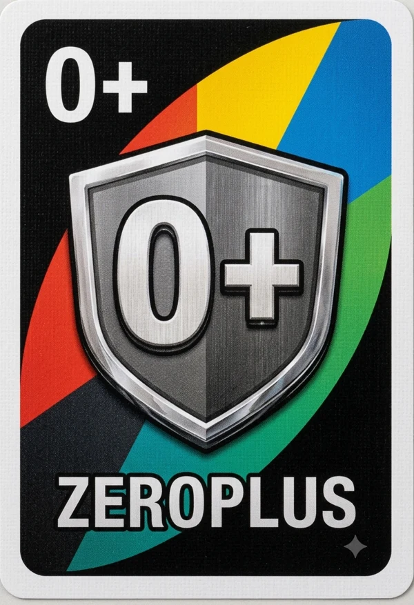
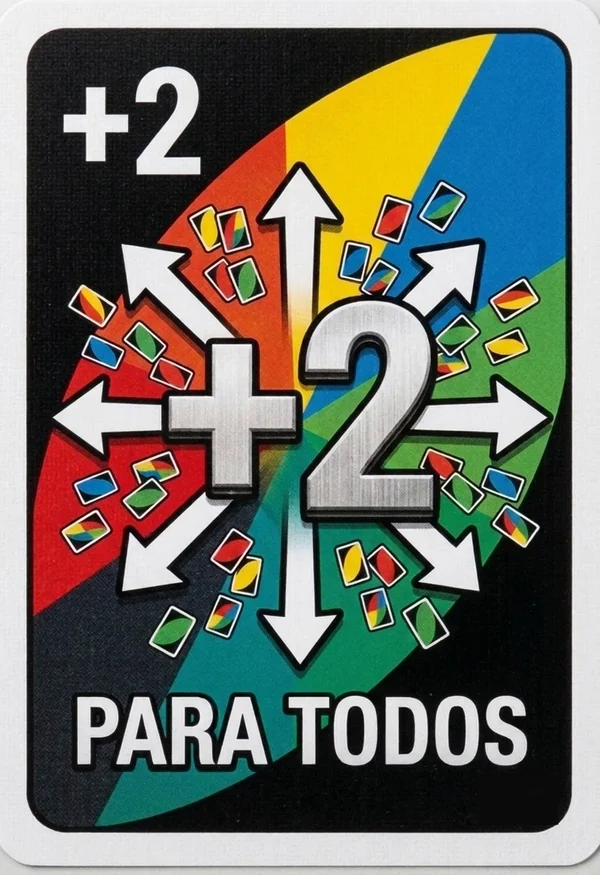
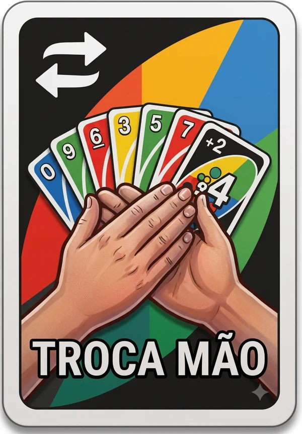
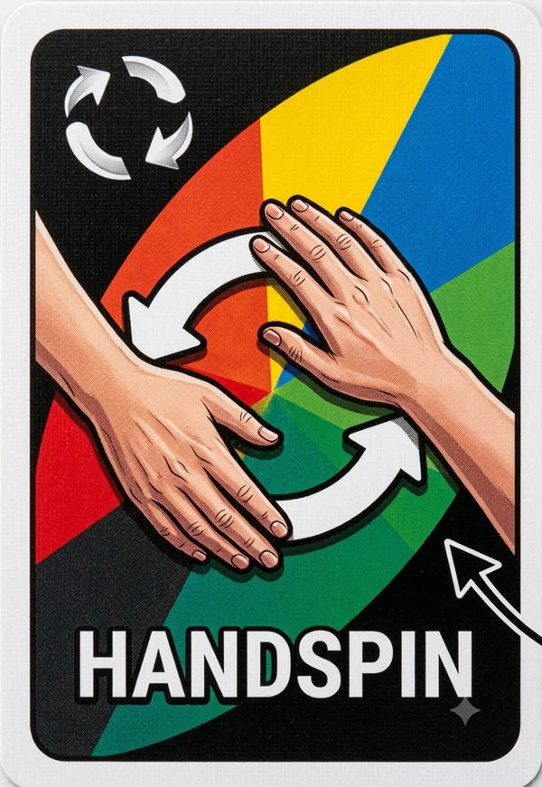
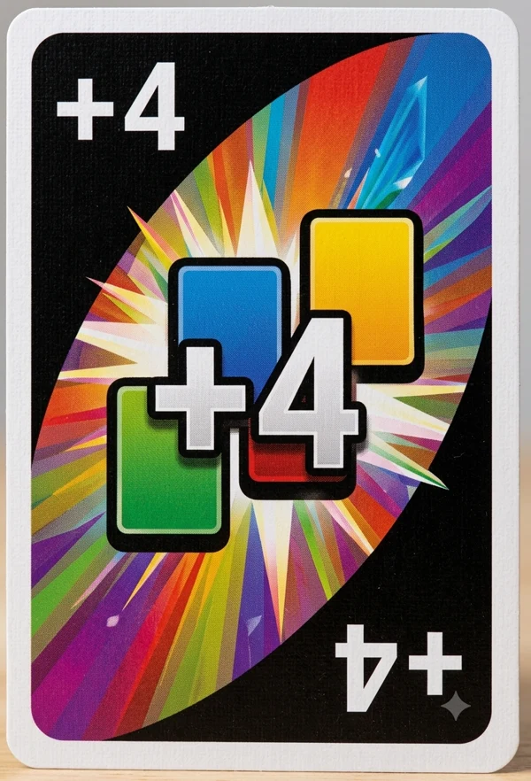
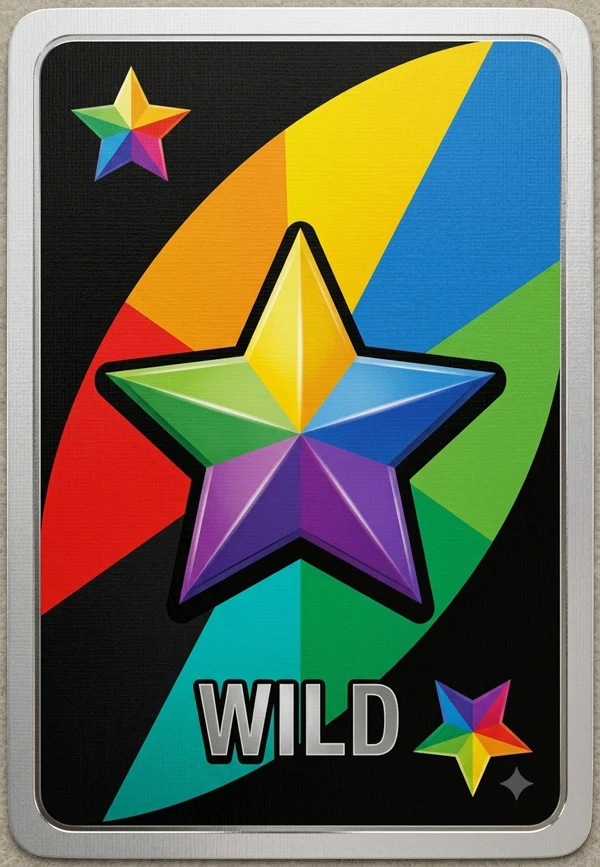

# Página Editorial do KabemJunto — Portal Kabem Jogos

> **Rota sugerida no portal:** `https://jogos.kabemmanager.online/jogos/kabemjunto/`
> **Objetivo:** Dar ao KabemJunto uma página de apresentação dedicada (nos moldes de `/jogos/turbo-mare/`) para converter tráfego frio de redes sociais, SEO e links de bio antes de mandar o jogador para `https://kabemjunto.kabemmanager.online/`.

---

## 0. Metadados, SEO e Ajuste no Card do Catálogo

### Meta Tags da Página

- **`<title>`:** `KabemJunto — O jogo de cartas que te denuncia | Kabem Jogos`
- **`meta description`:** `Jogue KabemJunto grátis no navegador com 2 a 10 jogadores, sem cadastro. Mesa 3D, Regra do 7 no chat, Corta-Frente e 0+ Zero Mais para devolver ataques.`
- **`og:title`:** `KabemJunto — O jogo de cartas que te denuncia`
- **`og:description`:** `Até 10 na mesa, zero cadastro e muita reviravolta. Conheça as cartas especiais e jogue agora no celular ou PC.`

### Ajuste sugerido no Card do KabemJunto na Home de `jogos.kabemmanager.online`

Hoje o card leva direto para o app. Para espelhar o padrão do _Turbo Maré_ (`Jogar` + `Ver pistas`), adicione um botão secundário:

- **CTA Primário:** `Jogar ↗` → `https://kabemjunto.kabemmanager.online/`
- **CTA Secundário:** `Como jogar →` → `https://jogos.kabemmanager.online/jogos/kabemjunto/`

---

## Seção 1 — Hero (Dobra Principal)

**Eyebrow:** `CARTAS · 2 A 10 JOGADORES · CELULAR E PC`

**H1:**

# KABEMJUNTO

### O jogo de cartas que te denuncia.

**Subtítulo:**
Reúna até 10 pessoas na mesma mesa 3D direto pelo navegador — sem baixar nada e sem criar conta. Sobreviva à **Regra do 7**, corte a frente fora da vez e devolva o `+4` acumulado com o **0+ Zero Mais**.

**Badges de confiança (linha discreta):**
`Grátis` · `Sem cadastro` · `Online e Offline (PWA)` · `Baralho de 109 cartas`

**CTAs:**

- **Botão primário (âmbar `#f59e0b`):** `Jogar KabemJunto agora ↗` (`https://kabemjunto.kabemmanager.online/`)
- **Botão secundário (contorno):** `Ver cartas especiais ↓` (âncora para a Seção 3)

**Visual sugerido ao lado/abaixo:** Leque das 6 cartas padronizadas em PT-BR sobre um print limpo da Mesa 3D (tema _Floresta_, sem o balão de dicas).

---

## Seção 2 — O que faz o KabemJunto virar caos em segundos

**Título da seção:** `4 regras que mudam tudo na mesa`

_(Grade 2×2 de cards com ícone + título + copy curta)_

1. **🤫 Regra do 7 (Silêncio no Online)**
   O 7 parece uma carta comum, sem aviso na face. Mas assim que cai na mesa, o silêncio vale até o próximo descarte: no modo Online, quem mandar mensagem ou fala rápida no chat leva **+2 cartas na hora**.
2. **🛡️ 0+ Zero Mais (Reflexo Indefensável)**
   Empilharam `+2` e `+4` em cima de você? Jogue o **0+ Zero Mais** e devolva a pilha inteira direto para quem atacou por último — sem direito a defesa.
3. **⚡ Corta-Frente (Roube a vez)**
   Tem uma carta **exatamente igual** (mesma cor e mesmo número/ação) à que acabou de cair? Arraste antes do anel acabar para cortar a frente fora da vez e puxar o ritmo da mesa para você.
4. **🃏 Descarte Múltiplo & Ataque Assimétrico**
   Junte cartas da mesma face para descarregar tudo de uma vez. Nos ataques, `+2` soma com `+2` e `+4` cobre `+2` ou `+4` — mas **`+2` em cima de `+4` é proibido**.

---

## Seção 3 — Vitrine das 6 Cartas Especiais (Baralho de 109 Cartas)

**Título da seção:** `As cartas que viram a partida`
**Subtítulo:** `Além das 100 cartas coloridas em 4 cores acessíveis (Laranja, Azul, Verde e Preto), 9 cartas neutras transformam qualquer turno em reviravolta.`

```carousel

<!-- slide -->

<!-- slide -->

<!-- slide -->

<!-- slide -->

<!-- slide -->

```

### Tabela-resumo para os cards da vitrine (copy pronta)

| Carta             | Qtd | Descrição curta (1 frase para o site)                              |
| :---------------- | :-: | :----------------------------------------------------------------- |
| **0+ Zero Mais**  |  1  | Devolve toda a pilha de ataque para o último atacante, sem defesa. |
| **+2 Para Todos** |  1  | Faz todos os adversários comprarem 2 cartas na hora e muda a cor.  |
| **Troca Mão**     |  1  | Escolha um adversário na mesa e troque todas as cartas com ele.    |
| **Gira Mão**      |  1  | Todo mundo passa a mão para o vizinho no sentido da rodada.        |
| **+4**            |  4  | Obriga o próximo a comprar 4 (ou empilhar) e define a nova cor.    |
| **Coringa**       |  1  | Troca a cor ativa do jogo na hora que você precisar.               |

---

## Seção 4 — Como jogar em 4 passos

**Título da seção:** `Aprenda jogando — sem manual de 10 páginas`

1. **Escolha a mesa:** Entre em **Jogar agora** (mesa pública que completa com bots em até 10 s), crie uma sala privada com código para amigos ou jogue **só contra bots**.
2. **Arraste a carta que brilha:** Na sua vez, as cartas válidas se destacam na mão. Arraste uma até o centro da mesa 3D (ou toque duas vezes).
3. **Combine ou compre:** Toque em cartas da mesma face para jogar em grupo. Se nada servir, toque no monte para comprar — se a carta comprada servir, você já pode jogá-la.
4. **Esvazie a mão primeiro:** Quem descartar a última carta vence na hora. Dicas rápidas aparecem na mesa na primeira vez que cada regra acontece.

---

## Seção 5 — Jogue do seu jeito (Modos & Personalização)

**Título da seção:** `Do grupo no WhatsApp ao modo avião`

- **🌐 Mesa Pública Rápida (`Jogar agora`):** Escolha de 2 a 10 lugares. Se não lotar em 10 segundos, os bots completam a mesa para você não ficar esperando.
- **👥 Sala com Amigos:** Crie uma sala privada (ou pública), copie o código de 6 letras e mande no WhatsApp ou Discord. Chat completo e 6 falas rápidas integradas.
- **✈️ Offline contra Bots (PWA):** Instale o KabemJunto na tela inicial do celular e jogue contra bots mesmo sem internet.
- **🎨 Sua mesa, seu estilo:** Escolha entre **12 avatares** e **3 temas de mesa** (_Floresta_, _Neon_ e _Areia_), com suporte a **Mesa 2D** automática em aparelhos sem WebGL, navegação por teclado e símbolos geométricos em cada cor para daltonismo.

---

## Seção 6 — Perguntas Frequentes (FAQ)

**Preciso baixar aplicativo ou criar conta?**
Não. O KabemJunto abre direto no navegador do celular ou PC, sem cadastro. Se quiser jogar sem internet contra bots, basta instalar como PWA pelo menu do navegador ("Adicionar à Tela de Início").

**Quantas pessoas podem jogar juntas?**
De **2 a 10 jogadores** na mesma partida — seja em sala online com amigos, mesa pública rápida ou contra bots no seu aparelho.

**A Regra do 7 usa o microfone do celular?**
Não. O KabemJunto não acessa seu microfone. No modo Online, a Regra do 7 monitora o chat escrito e as falas rápidas dentro da sala: quem enviar mensagem durante o silêncio compra +2 cartas automaticamente.

**Posso jogar `+2` em cima de `+4`?**
Não! No KabemJunto o acúmulo é assimétrico: `+2` acumula com `+2`, `+4` cobre `+2` e `+4` cobre `+4`, mas `+2` sobre `+4` é proibido. Para devolver um `+4`, só com outro `+4` ou com o **0+ Zero Mais**.

**Funciona em celulares mais simples?**
Sim. Além da Mesa 3D leve carregada sob demanda, o jogo possui uma **Mesa 2D** embutida com exatamente as mesmas regras e interações.

---

## Seção 7 — CTA Final (Fechamento)

**Título:** `Pronto para ver quem cai no 7 primeiro?`
**Subtítulo:** `Chame o grupo pelo código da sala ou use o Card de Desafio no menu para provocar no Status.`
**Botão primário:** `Abrir KabemJunto e jogar grátis ↗` (`https://kabemjunto.kabemmanager.online/`)
**Link secundário:** `← Voltar ao catálogo Kabem Jogos` (`https://jogos.kabemmanager.online/`)
